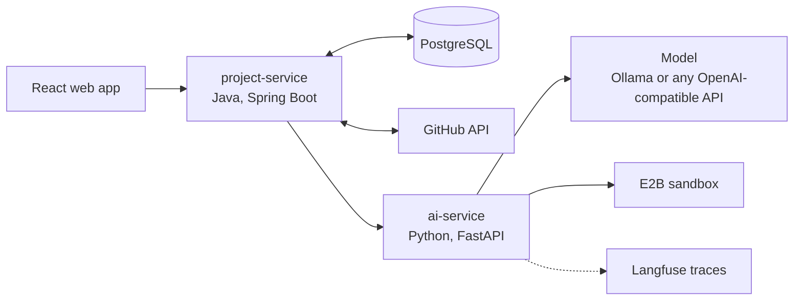

# ForgeAI

ForgeAI takes a GitHub repository and a task written in plain English, and
works towards a tested pull request: it analyses the repository, plans the
change, writes the code, runs the repository's tests in an isolated sandbox,
tries to fix what fails, and opens a pull request for a human to review.

It is a learning project built to be read: two small services, no agent
framework, and tests at every layer.



- **project-service** owns users, authentication, GitHub access, the record of
  each run, and the pull request. It never calls a model.
- **ai-service** owns every prompt, model call and sandbox run. It holds no
  state and no user credentials.

How a run moves through the system, and why it is built this way, is in
[docs/architecture.md](docs/architecture.md).

## What works today

| Stage | State |
|---|---|
| Sign-up, login (JWT), project ownership | Working, tested |
| GitHub OAuth, reading a repository at a fixed commit | Working, tested |
| Repository analysis, task planning, code generation | Working against a local model (Ollama) and Gemini's free API |
| Running tests in an E2B sandbox | Working against real E2B |
| Diagnose-and-fix loop (up to 3 attempts) | Working; see results below for how often it succeeds |
| Langfuse tracing | Working against Langfuse Cloud |
| Background runs with a pollable status | Working: a real run went from task to pull request in 4 min 05 s |
| Opening the pull request | Working: opened (and the owner merged) a real pull request on the demo repository |
| React web app | Tested in a real browser at desktop and phone sizes; see [Frontend](#frontend) |
| Maven and Gradle repositories | Not supported yet (needs a sandbox image with a JDK) |

## Results

The same eight tasks were run against the [demo repository](demo/registration-service),
from the same starting commit, with two models. A task is solved only if the
agent's own tests pass **and** a hidden acceptance test, which the agent never
sees, also passes.

| Model | Solved | Mean attempts | All eight tasks | Sandbox credit |
|---|---|---|---|---|
| Gemini 3.5 Flash, free API tier | **8 of 8** | 1.1 | 8.8 min | about $0.008 |
| `qwen3:8b` on a laptop GPU, through Ollama | 3 of 8 | | 45 min | about $0.007 |

Each row is a single sweep of eight small tasks on a small repository, so read
it as a comparison between the two models, not as a general success rate. With
every task now solved, this benchmark has stopped telling configurations apart;
harder tasks are the next thing it needs.

### Evaluation with Gemini: 8 of 8 tasks solved

Measured on 20 October 2026 with `LLM_MODEL=gemini-3.5-flash` and the two Flash
Lite models as fallbacks for when it is busy (see
[Choosing a model](#choosing-a-model)).

| Task | Agent's own tests | Attempts | Hidden test | Solved | Time |
|---|---|---|---|---|---|
| Reject invalid emails | passed | 2 | passed | yes | 82 s |
| Reject short passwords | passed | 1 | passed | yes | 48 s |
| Reject duplicate emails | passed | 1 | passed | yes | 163 s |
| Add `GET /users/{id}` | passed | 1 | passed | yes | 57 s |
| Add `DELETE /users/{id}` | passed | 1 | passed | yes | 51 s |
| Add `GET /health` | passed | 1 | passed | yes | 48 s |
| Add `GET /users/count` | passed | 1 | passed | yes | 41 s |
| Normalise stored emails | passed | 1 | passed | yes | 37 s |

"Reject invalid emails" failed its first test run and passed after one round
of diagnose and fix. All eight took 8.8 minutes and 279 seconds of sandbox time.

### Evaluation with a local model: 3 of 8 tasks solved

Everything in this section was measured on one laptop (Intel i5-11400H, 16 GB
RAM, GTX 1650 with 4 GB VRAM) running `qwen3:8b` through Ollama, which on this
hardware produces about 4 to 5 tokens per second.

| Step | Typical time |
|---|---|
| Repository analysis | about 60 s |
| Engineering plan | about 75 s |
| A single-file task, start to finish | about 2.5 min |
| A three-file task with correction attempts | 12 to 13 min |
| Sandbox setup (clone and install) | about 12 s |
| One test run in the sandbox | about 1 s |
| E2B credit per run (estimated) | $0.001 to $0.002 |

| Task | Agent's own tests | Attempts | Hidden test | Solved | Time |
|---|---|---|---|---|---|
| Add `GET /health` | passed | 1 | passed | yes | 148 s |
| Add `GET /users/count` | passed | 1 | passed | yes | 150 s |
| Normalise stored emails | passed | 2 | passed | yes | 550 s |
| Reject short passwords | passed | 1 | **failed** | no | 165 s |
| Reject duplicate emails | failed | 1 | not run | no | 520 s |
| Add `GET /users/{id}` | failed | 1 | not run | no | 402 s |
| Add `DELETE /users/{id}` | failed | 3 | not run | no | 645 s |
| Reject invalid emails | no valid output | 0 | not run | no | 130 s |

All eight together took 45 minutes and 235 seconds of sandbox time, an
estimated $0.007 of E2B credit. Raw results are in
[services/ai-service/evals/results](services/ai-service/evals/results).

What the failures show:

- **The hidden test matters.** "Reject short passwords" passed the tests the
  agent wrote for itself and still had the behaviour wrong.
- **Self-correction works when the model can act on a diagnosis.** "Normalise
  stored emails" failed its first test run and passed on the second attempt.
- **The most common failure is the model returning a file unchanged** when
  asked to write or fix it (three of the five failures). The pipeline detects
  this and stops instead of looping, but cannot make the model do the work.
- A harder task that changes three files at once ("validate email and
  password, with tests") was run end to end three times and did not pass
  within three attempts in any of them. Each run failed differently: a missing
  dependency, a test fixture lost in a rewrite, a syntax error.

In the full flow a pull request is only opened when the agent's tests pass, so
four of these five failures would have stopped before reaching a repository.
The fifth, "Reject short passwords", would have become a pull request with the
wrong behaviour. That is why the last step is a human review, not a merge.

The model is the limiting factor here, and it is swappable: any
OpenAI-compatible endpoint can be used by changing three environment variables.
The same tasks on Gemini's free tier, above, were all solved.

### Choosing a model

**Hosted, free.** Gemini's free tier sets a separate daily limit for each
model, shown in Google AI Studio. In October 2026 the newest Flash models
allowed only 20 requests a day, while the Flash Lite models allowed 500. One
run makes roughly 6 to 15 model calls, so the default order is chosen by
allowance as much as by quality: `gemini-3.5-flash`, then `gemini-3.5-flash-lite`
and `gemini-3.1-flash-lite` in `LLM_FALLBACK_MODELS`. When a model answers
"too many requests" (429), is overloaded (5xx) or drops the connection, the
next one is asked at once, without waiting out retries.

**Local.** The default local model, `qwen3:8b`, does not fit in 4 GB of VRAM, so most of it runs on the CPU.
A smaller model that fits entirely on the GPU was measured on the same eight
tasks, from the same starting commit:

| Model | Runs on | Time for one 5,600-token call | Solved | Time for all 8 |
|---|---|---|---|---|
| `qwen3:8b` (default) | 64% CPU, 36% GPU | 212 s | 3 of 8 | 45 min |
| `Qwen2.5-Coder-3B` | 100% GPU | 42 s | 1 of 8 | 10.5 min |

Each figure is from a single sweep of eight tasks, so the difference in tasks
solved is indicative, not precise. The smaller model is about five times
faster and clearly weaker. `infrastructure/ollama/Modelfile.fast` sets it up.

## Design points worth a look

- **Model output is never trusted.** Every reply is validated against a schema
  and against the real repository (paths must exist, new files must be new,
  nothing may escape the repository or touch CI workflows). Invalid replies get
  one repair attempt with the specific errors.
- **The plan decides where code goes.** During generation the model supplies
  file content only; it cannot choose a path or delete a file.
- **Diagnose, then fix.** A failed test run produces a structured root cause
  first, and only the files it names are rewritten.
- **Generated code runs only in a sandbox.** A change is proposed, as a pull
  request on a new branch, when its tests pass. If tests fail, nothing is
  proposed. If the repository has no tests at all, the pull request is opened
  with `[Untested]` in its title and a warning at the top, so a reviewer knows
  nothing vouches for it.
- **Runs are asynchronous and durable.** `POST /runs` returns `202`; progress is
  a database row. A partial unique index guarantees one active run per project
  even under concurrent requests.
- **Secrets.** GitHub tokens are encrypted at rest with AES-256-GCM and leave
  the Java service only for private clones. No secret lives in the repository.
- **Costs are bounded.** Sandboxes have a hard lifetime and are always
  destroyed; each run records sandbox seconds and an estimated credit cost.
  The whole stack runs on free tiers.

## Deploy it for free

[render.yaml](render.yaml) describes the whole deployment for Render's free
plan: the web app as a static site, and the two services as free Docker
instances. The database is Neon's free Postgres and the model is Gemini's free
API tier, so nothing runs on your own machine and no step needs a payment
method. [docs/deployment.md](docs/deployment.md) walks through it.

What changes when it is deployed:

- The web app and the API live at different addresses. The API allows
  cross-origin calls from the web app's address and no other.
- Free Render services cannot talk over a private network, so the AI service is
  public. It answers only requests carrying a shared secret that the Blueprint
  generates for both services.
- Anyone can sign up, but only listed accounts can start runs, and each account
  has a daily limit: every run spends real model and sandbox quota.
- Free services sleep when idle. The web app wakes both services as soon as it
  opens. Measured under the free plan's limits (512 MB, 0.1 CPU), the Java
  service starts in about 56 s, down from 99 s, using a class data archive built
  into the image, and runs in about 190 MB.

## Run it locally

Prerequisites: JDK 21+, Python 3.13, Docker, and [Ollama](https://ollama.com).
Free accounts on [E2B](https://e2b.dev) and [Langfuse](https://langfuse.com)
are optional; without them, sandbox runs report "unavailable" and tracing is off.

```bash
# 1. Secrets
cp .env.example .env          # then fill it in; the file explains each value

# 2. Model (once)
ollama pull qwen3:8b
ollama create forgeai-qwen3 -f infrastructure/ollama/Modelfile

# 3. Database and Java API (http://localhost:8080)
docker compose up -d postgres
./start-forgeai.sh

# 4. AI service (http://localhost:8001), in a second terminal
cd services/ai-service
python -m venv .venv && source .venv/Scripts/activate   # bin/activate on Linux/macOS
pip install -r requirements-dev.txt
python -m uvicorn app.main:app --port 8001

# 5. Web app (http://localhost:5180), in a third terminal
cd frontend
npm install
npm run dev
```

In the web app: create an account, connect GitHub in Settings, create a project
for a repository you own, type a task and start a run.

To use a different model, set `LLM_BASE_URL`, `LLM_API_KEY` and `LLM_MODEL` in
`.env`. Any OpenAI-compatible endpoint works; no code changes are needed.

Both services can also run in containers: `docker compose --profile app up --build`.

## API

All endpoints except register, login and the OAuth callback need
`Authorization: Bearer <token>`. Errors are RFC 9457 problem documents.

| Method and path | Purpose |
|---|---|
| `POST /api/v1/auth/register`, `POST /api/v1/auth/login` | Create an account, get a token |
| `GET /api/v1/auth/github/url` | URL that starts the GitHub OAuth flow |
| `POST /api/v1/projects`, `POST /api/v1/projects/{id}/github` | Create a project, link a repository |
| `POST /api/v1/projects/{id}/runs` | Start a run; answers `202` with a `Location` to poll |
| `GET /api/v1/runs/{runId}` | Status, analysis, plan, changes, attempts, pull request |
| `GET /api/v1/projects/{id}/runs` | Run history |
| `GET /api/v1/github/projects/{id}/ai-analysis` | Analysis only |
| `POST /api/v1/github/projects/{id}/plan` | Plan only |
| `POST /api/v1/github/projects/{id}/generate` | Generate changes for a plan, without testing |

## Tests

| Suite | Tests | What it needs |
|---|---|---|
| `services/project-service` (`./mvnw verify`) | 126 | Docker, for a throwaway PostgreSQL |
| `services/ai-service` (`pytest`) | 161 | Nothing: the model, E2B and Langfuse are faked |
| `frontend` (`npm test`) | 38 | Nothing: logic and components in jsdom |
| `frontend` (`npm run test:e2e`) | 39, each at desktop and phone size | Chromium; the API is mocked |

CI runs all three on every push without any secrets, and also builds the two Docker images that the deployment uses.

To measure the agent itself, the evaluation harness runs real tasks against a
real repository. A task counts as solved only if the agent's own tests pass
**and** a hidden acceptance test, which the agent never sees, also passes:

```bash
cd services/ai-service
python -m evals.run --repo <owner>/<name> --max-tasks 2
```

## Frontend

The web app in [frontend/](frontend/) is React and TypeScript on Vite, with React
Router and TanStack Query. It has no UI kit and no CSS framework: the look is a
small set of design tokens and CSS Modules. It has no animation library either:
all motion is CSS and the View Transitions API, plus about a hundred lines of
hooks in [frontend/src/lib/motion.ts](frontend/src/lib/motion.ts).

- **Pages:** landing, sign in, create account, projects, new project, project
  (start a run, history), run (progress, plan, diff, test attempts, analysis),
  settings, and a not-found page.
- **View Transitions API:** pages move in the direction you are going (deeper
  slides in from the right, back from the left, sideways cross-fades). The
  header stays in place, the line under the current section slides to the one
  you pick, and the title of the project or run you open travels from the list
  into the page heading. Browsers without the API just navigate.
- **One motion system:** four durations and four easing curves, defined once as
  tokens in [tokens.css](frontend/src/styles/tokens.css), are the only timings
  in the app. The spring curve is sampled from a damped spring, not drawn by eye.
- **A run you can watch:** while a run is in progress the step tracker draws
  each tick, fills the line to the next step and shows which step is working.
  The home page replays a real run the same way.
- **Scroll:** sections arrive as they are scrolled to, and two effects are tied
  to the scroll position itself with CSS scroll-driven animations (the header
  lifting off the page, and a line that fills beside "How it works"). Where
  those are not supported, the page is simply still.
- **Light and dark:** every colour is declared once with `light-dark()`. The
  theme follows the device until you choose one; the choice is applied before
  the first paint, and the new theme spreads out from the button you pressed.
- **Loading:** placeholders are shaped like the content they stand in for and
  wait a moment before showing, so a fast response never flashes one.
- **Responsive:** written phone-first. A browser test loads every page at
  390 px and fails if any of them scrolls sideways; wide content such as diffs
  and test output scrolls inside its own box.
- **Accessible:** real labels and error messages on form fields, keyboard
  navigation for tabs, a skip link, and status never shown by colour alone.
  With "reduce motion" switched on in the operating system nothing animates and
  nothing waits to be revealed; a browser test checks this.
- **Live without a refresh:** a run page polls only while the run is active and
  stops when it finishes.
- **A correct diff after merge:** changes are compared with the file at the
  commit the run started from, not with today's branch.

The login token is kept in `localStorage`, which is simple and survives a
reload, but is readable by any script on the page. That is acceptable for a
demo that ships no third-party scripts; a production system would use an
HttpOnly cookie.

## Limits

- A small local model is slow and frequently wrong; the numbers above say how
  often. The system is designed so a wrong change is caught, not merged.
- Whether a repository has tests is judged from the files that were read (up
  to 200). In a monorepo with several packages, only the first one is tested.
- Runs execute inside the Java process and are not resumed after a restart.
- Generation rewrites whole files, so only files that fit the model's context
  can be changed.
- The sandbox has internet access while tests run.
- More in [docs/architecture.md](docs/architecture.md#known-limits).

## Repository layout

```
services/project-service/   Java control plane (API, auth, GitHub, runs)
services/ai-service/        Python agent (analysis, plan, generate, sandbox, loop)
services/ai-service/evals/  Evaluation tasks and harness
frontend/                   React web app
demo/registration-service/  Small target repository used for demos and evals
infrastructure/             Ollama Modelfile, E2B template, database init
docs/architecture.md        How it works and why
```
