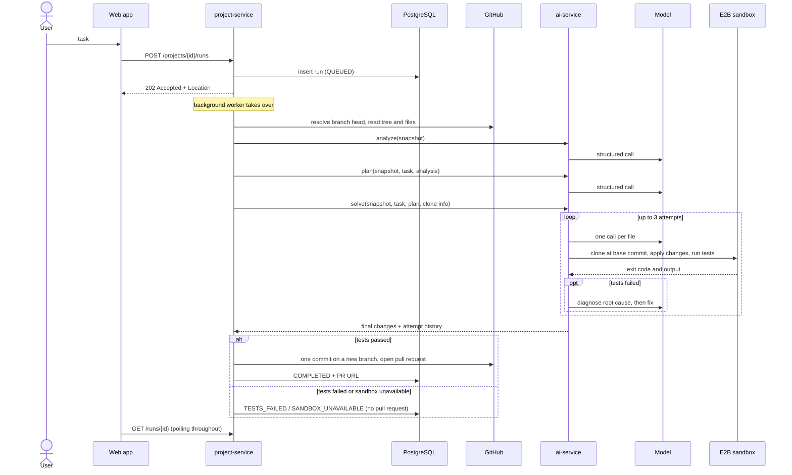
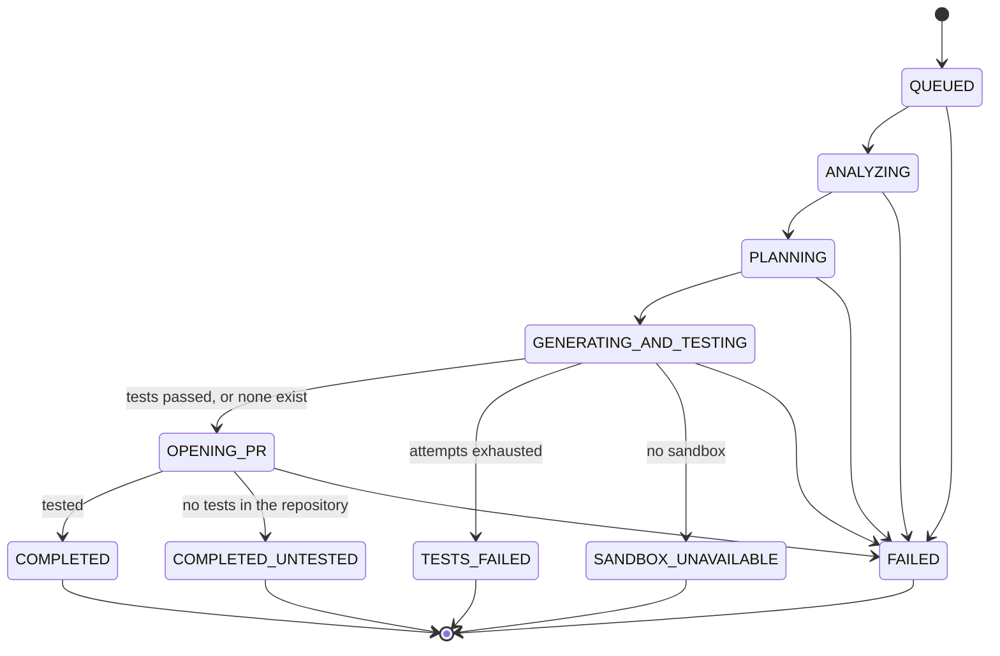

# ForgeAI architecture

This document explains how a task becomes a pull request, which component owns
which decision, and why the system is shaped the way it is.

## Components

| Component | Owns | Does not do |
|---|---|---|
| **project-service** (Java, Spring Boot) | Users, JWT auth, project ownership, GitHub OAuth and API calls, the agent-run record, opening the pull request | Any model call or prompt |
| **ai-service** (Python, FastAPI) | Prompts, model calls, output validation, the sandbox, the self-correction loop, tracing | Authentication, GitHub writes, persistence |
| **PostgreSQL** | Users, projects, GitHub connections, agent runs | |
| **Google Gemini** (free API tier) | Inference, with fallback to smaller models when one is busy | |
| **E2B** | Running untrusted generated code and the repository's tests | |
| **Langfuse** (optional) | Traces of runs, attempts and model calls | |
| **Web app** (React) | Pages for projects and runs; a live view of one agent run | Any business logic; it only calls the Java API |

The split follows trust and state. Everything that needs a user's identity or
their GitHub token lives in Java. Everything that touches a model lives in
Python, which is stateless: it receives a prepared repository snapshot and
returns structured results.

## One agent run

### Run states

A run takes minutes, so it cannot live inside an HTTP request. `POST .../runs`
records the run and returns `202`; a bounded background executor does the work
and saves every step to the `agent_runs` row, which is what clients poll.

Two rules protect that record:

- **One active run per project.** The service checks first, and a partial unique
  index on `agent_runs(project_id) WHERE status IN (active states)` makes the
  rule hold when two requests arrive together.
- **No run stays "in progress" forever.** Any exception ends the run as `FAILED`
  with its message, and runs left in flight by a restart are closed at startup.

## Keeping a language model on a short leash

The model's output decides which files are written, executed and committed, so
none of it is trusted until it has been checked.

| Risk | Control |
|---|---|
| Malformed or incomplete output | Every call requests JSON for a Pydantic schema, validates it, and gives the model one chance to repair it using the specific errors |
| Invented file paths | Plans are checked against the snapshot: files to modify must exist, files to create must not |
| Writing outside the task | The plan fixes each file's path and action; during generation the model supplies content only |
| Path traversal, `.git`, CI workflows | `path_safety` rejects them in plans, in diagnoses, and again before anything is written to the sandbox |
| "... rest of code" placeholders, truncated files | Detected and sent back for repair; files too large for the model context are refused, not truncated |
| Instructions hidden in repository files | System prompts mark repository content and test output as untrusted data |
| Generated code doing damage | It only ever runs inside an E2B sandbox, never on the host |
| A bad change reaching the repository | Changes are only ever proposed on a new branch, as a pull request a human must merge. Failing tests mean no pull request at all |
| A repository with no tests | Detected before a sandbox is started. The pull request is still opened, but its title starts with `[Untested]` and its body opens with a warning |

## Design decisions

**One model call per file.** Several whole files in one reply is where output
gets cut off or files get mixed up. One file per call keeps replies small and
lets each later file see the new version of the ones before it.

**Diagnose before fixing.** On a test failure the model must first produce a
structured diagnosis (root cause, fix strategy, files to change). Only those
files are rewritten, with the diagnosis and the exact test output as feedback.

**A sandbox per attempt, not per run.** Measured setup time is about 12 seconds;
the model's diagnosis and fix take longer than that between attempts. A sandbox kept open across
attempts would mostly be billed for sitting idle.

**Read the repository once, at one commit.** The branch head is resolved to a
commit SHA, the whole tree is read in one request, and that same commit is what
the sandbox clones and what the pull request builds on.

**One atomic commit.** Changes are published through the Git data API (tree,
commit, ref) so a multi-file change is one commit, not one commit per file.

**Prompt budgeting in Python.** Java caps a snapshot at 200 files and 5 MB, far
far more than is useful in one prompt. Python always lists every path, then includes
file contents in priority order until a character budget is reached.

**The GitHub token stays in Java.** It is encrypted at rest (AES-256-GCM, key
from the environment). It is passed to the AI service only when a private
repository must be cloned, and there it reaches git through an environment
variable, never a command line, URL or `.git/config`.

## What is deliberately not here

Kafka, a worker fleet and a gateway were considered early and dropped: the
product is one workflow, and a database row plus a bounded executor is enough to
run it. LangChain and similar frameworks are not used; the agent is
about 2,000 lines of plain Python that can be read top to bottom.

## Known limits

- Runs execute inside the Java process. A restart fails in-flight runs; they are
  not resumed.
- OAuth state is held in memory, so it does not survive a restart or work across
  several instances.
- Maven and Gradle repositories need a custom E2B template with a JDK
  (`infrastructure/e2b`); it has not been built or tested.
- Code generation rewrites whole files, which limits it to files that fit the
  model's context (8,000 characters by default).
- The sandbox has internet access while tests run, because dependencies are
  installed there.
